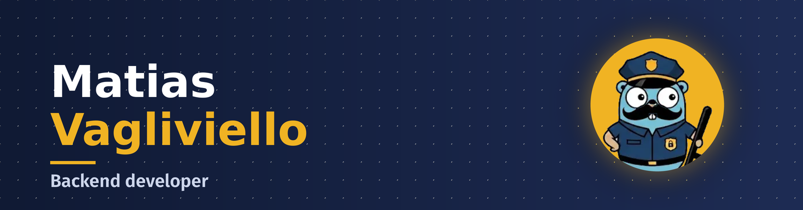
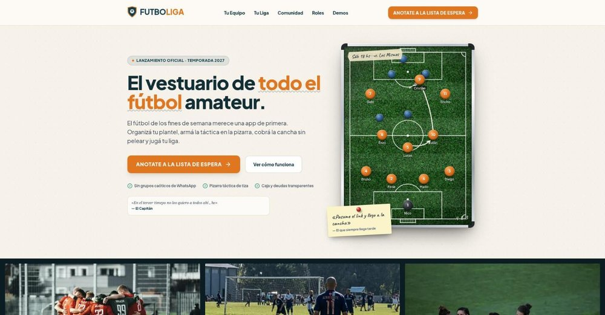
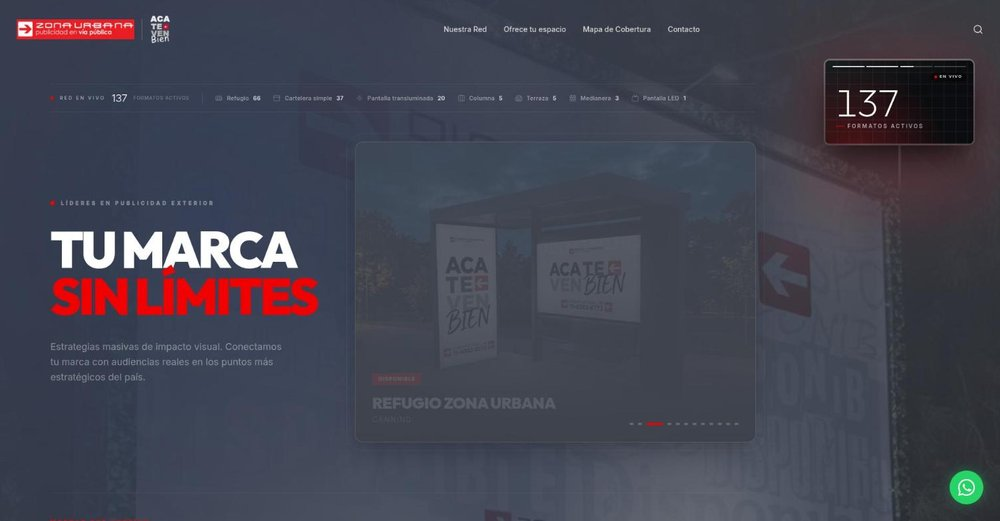

  

 

---

## 🧠 Quién soy

Soy **backend developer** y me especializo en lo que no se ve, pero se nota cuando falla:

- 💸 que **el dinero no se pierda** cuando un servicio se cae a mitad de una transferencia;
- 🛡️ que un **agente de IA no pueda robar credenciales** ni filtrar datos sin que nadie se entere;
- ⚡ que un listado **no se vuelva lento** cuando la base crece.

Diseño con **DDD**, pruebo la lógica donde importa y construyo **de punta a punta**:
del modelo de dominio a la API, y de ahí a la pantalla. Además me meto de lleno en
**IA aplicada**: MCP servers, RAG y herramientas para que los equipos trabajen mejor con LLMs.

## 🛠️ Stack

## 🌍 Abiertos a la comunidad

Código abierto: usalo, rompelo, abrí un issue o mandá un PR.

| Proyecto | Qué es |
|---|---|
| 💸 [**Microservicios**](https://github.com/matiasvagli/Microservicios) | Billetera digital en microservicios: gateway + 4 servicios, **Saga Pattern** con compensaciones, eventos e idempotencia. |
| 🔍 [**SkillAudit**](https://github.com/matiasvagli/skillaudit) | Un MCP server que **audita otros MCP servers**: los corre en Docker aislado y observa su comportamiento real, en vez de confiar en el código. |
| 🧩 [**ragkit**](https://github.com/matiasvagli/ragkit) | Pipeline de ingesta RAG autoconfigurable para NestJS: elegís el proveedor de IA y el resto se configura solo. |
| 🤝 [**Team Context MCP Server**](https://github.com/matiasvagli/Team-Context-MCP-Server) | Contexto compartido y persistente para equipos que trabajan con LLMs: que el conocimiento no se evapore cuando alguien se va. |
| ⚡ [**CRUDFULL**](https://github.com/matiasvagli/crudfull) | Generador de CRUDs para FastAPI con tres motores: sin base, SQLAlchemy async o MongoDB. |

## 🖼️ Landings en producción

Sitios que diseñé y publiqué para negocios reales. Click en la imagen para verlos en vivo.

<table>
  <tr>
    <td align="center" width="33%">
       
      <b>⚽ Futboliga</b> Ligas y equipos de fútbol amateur
    </td>
    <td align="center" width="33%">
       
      <b>🏡 Coruja Casas Serranas</b> Alquiler de casas serranas
    </td>
    <td align="center" width="33%">
       
      <b>📣 Zona Urbana Publicidad</b> Publicidad en vía pública
    </td>
  </tr>
</table>

## 🧭 Cómo trabajo

| Principio | Cómo se ve en la práctica |
|---|---|
| 🧱 **Dominio antes que código** | Modelo el dominio con DDD. Las reglas de negocio viven fuera del framework y se prueban sin levantar un servidor. |
| 🔁 **Consistencia bajo fallos** | Saga, outbox transaccional e idempotencia: si un paso falla, el sistema compensa en vez de quedar a medias. |
| 🔐 **Seguridad por defecto** | Secretos solo por entorno, todo input externo validado, queries parametrizadas y autenticación explícita en cada endpoint. |
| 📉 **Performance con guardas, no con reportes** | Todo listado va paginado y con un test automático que falla si la cantidad de queries crece con N. Los N+1 se cazan en el review, no en producción. |
| 🎯 **Simple antes que ingenioso** | La solución más simple que resuelva el problema, ordenada y sin capas "por si acaso". |
| ✅ **Tests donde importan** | Lógica de negocio, cálculos y casos borde. Sin perseguir cobertura por cobertura. |

## 📬 Hablemos

Estoy disponible para proyectos de backend, arquitectura e IA aplicada. Si tenés algo en mente, escribime.

